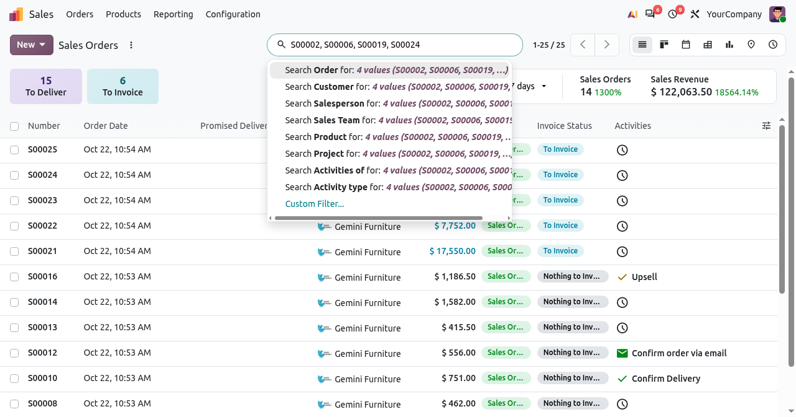
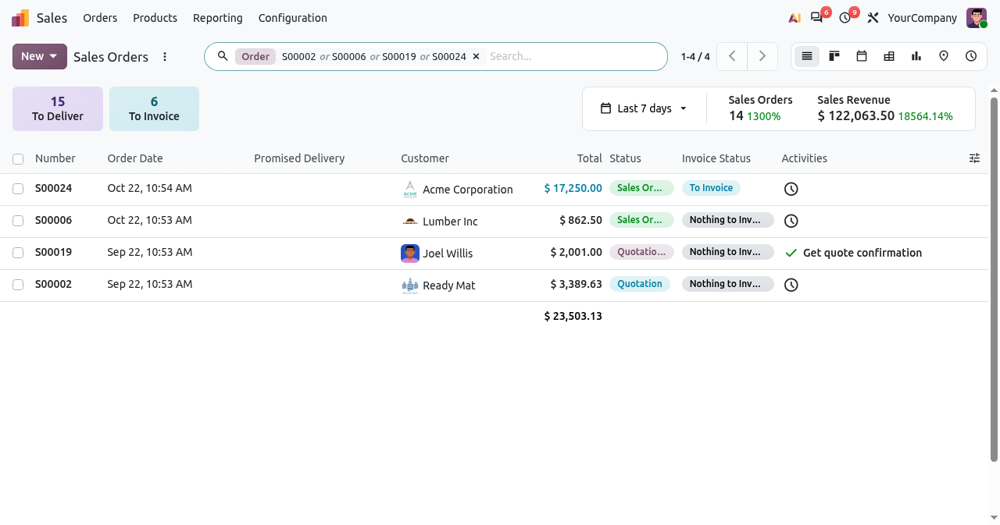
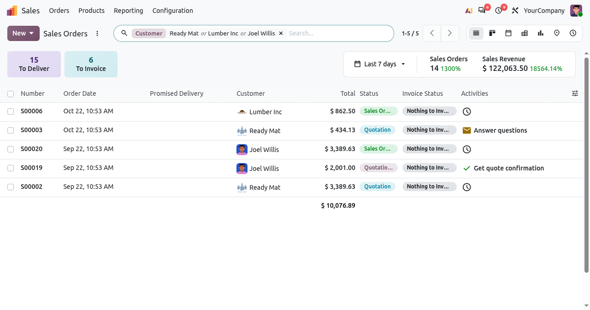

# Search Paste from Excel

Odoo module that lets users search a whole list of values at once. Copy cells from Excel and paste them
into the search bar of any view, or type values separated by commas, then choose the field: one filter
finds every record of the list.

**Odoo version:** 20.0 · **License:** LGPL-3 · **Editions:** Community, Enterprise, Odoo.sh

## Features

- **Paste cells from Excel:** a column, a row or a block of cells from Excel, Google Sheets or LibreOffice.
- **Or type with commas:** `S00002, S00006, S00019` (the Arabic comma `،` works too).
- **Pick the field:** the search bar proposes every field that can hold all the values (references,
  customers, products, numbers, dates, selections...).
- **One filter, exact match:** all the values go in one facet combined with "or". Each value is an exact
  match, not case sensitive, so `100` does not find `1000`.
- **Every view, every app:** list, kanban, pivot, graph... wherever there is a search bar.
- **Zero configuration:** empty cells and duplicates are ignored, and a single value keeps the standard search.

## Screenshots

Paste a column of order numbers: every field that can hold them is proposed.

Choosing **Order** adds one facet with the 4 values: exactly the 4 orders of the list are found.

Values typed with commas, searched in the **Customer** field:

## Installation

1. Copy the `web_search_paste` folder into your Odoo addons path.
2. Restart Odoo and update the apps list.
3. Install **Search Paste from Excel**.

The module only depends on `web` and has no Python code, so it can also be imported as a zip file
(Apps > Import Module).

## Usage

1. Open any view with a search bar, e.g. Sales > Orders.
2. Copy several cells in Excel and paste them in the search bar (or type values separated by commas).
3. Click the field to search them in, e.g. **Search Order for: 4 values (...)**.

## Author

**Hamid A Mohamed**. Questions, bugs or ideas: [LinkedIn](https://www.linkedin.com/in/hamid-abdalla-mohamed-39bb33205/).
